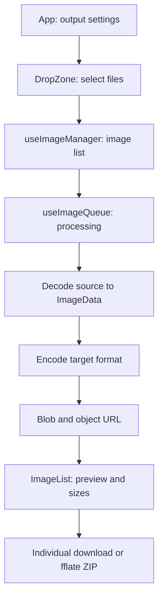

# Architecture

Squash is a static Vite application. React manages the interface and image state;
jSquash supplies WebAssembly codecs. There is no application backend.

| Location | Responsibility |
| --- | --- |
| `src/App.tsx` | Connect settings, uploads, state, and downloads. |
| `src/components/` | Upload area, format controls, and results. |
| `src/hooks/` | Image lifecycle and processing queue. |
| `src/files/decoders/` | Codec dispatch and module initialization cache. |
| `src/files/download.ts` | Browser downloads and ZIP creation. |
| `src/__tests__/` | Jest component, hook, and file utility tests. |

Processing marks each item as processing, complete, or error. Successful results
hold a Blob and a temporary object URL. The queue schedules codec calls in the
browser; it is not a dedicated application Web Worker pool. Tests mock codecs,
so passing unit tests does not establish real-browser codec compatibility.
