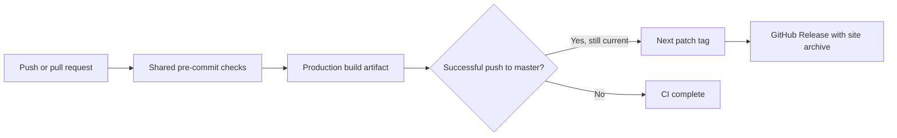

# Releases and hosting

## Continuous integration

Every push and pull request runs the shared checks in the committed Flox
environment. Successful runs upload the built `dist/` directory as the `site`
artifact, retained for seven days. Workflow permissions are read-only except for
the release job's permission to publish tags and releases.



## Automatic releases

After `ci` succeeds for a push to `master`, `auto-release` tags the tested commit
and publishes its exact build artifact. It starts at `v0.1.0` and increments the
patch number of the latest stable version. It skips superseded commits and
reuses an existing tag when rerun. Release notes come from GitHub. A draft is
published only after the archive and SHA-256 checksum are uploaded.

Download `squash-site.tar.gz` and its `.sha256` file from
[GitHub Releases](https://github.com/smeltery/squash/releases). The archive
includes the license. On Linux, verify it with:

```sh
sha256sum --check squash-site.tar.gz.sha256
mkdir squash-site
tar -xzf squash-site.tar.gz -C squash-site
```

On macOS use `shasum -a 256 -c squash-site.tar.gz.sha256` instead. If publication
fails after tagging, rerun the failed workflow while its CI artifact is still
available. Automatic releases do not change `package.json`'s private app version.

## Hosting

Serve the extracted directory from a static HTTP host at the domain root. Include
all assets, especially `.wasm` files, and serve WebAssembly as `application/wasm`.
Do not open `index.html` directly using `file://`. For a local production preview:

```sh
flox activate
bun install --frozen-lockfile
bun run build
bun run preview
```

For a subdirectory deployment, configure Vite's `base` and rebuild. Hosting is
separate from releases: these workflows publish artifacts, not a live site.
