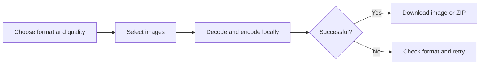

# Using Squash

Start a local instance using the [README](../README.md#run-locally), or open your
hosted instance in a browser with WebAssembly support.

1. Choose an output format. The initial selection is WebP at quality 75.
2. Adjust quality where available; see [format limitations](formats.md).
3. Drop supported images onto the upload area, or click it to select files.
4. Wait for each image to finish. Results show the original and output sizes.
5. Download an individual result, or use **Download All** to save completed
   images in a ZIP. Failed or unfinished images are excluded.
6. Remove individual items or select **Clear All** to reset the list.

Choose settings before adding a batch. Changing settings does not recompress
completed results. A new upload replaces the displayed list, so download your
current results first. Keep original files: compression can produce a larger
file, and lossy conversion discards image detail.

## Privacy and storage

The application reads selected files and runs codecs inside your browser; the
processing path does not upload image data to a server. Loading the app still
requests its scripts and codec assets from the host. Results are held in memory,
not a persistent library. Download them before clearing the list or closing or
refreshing the page.
